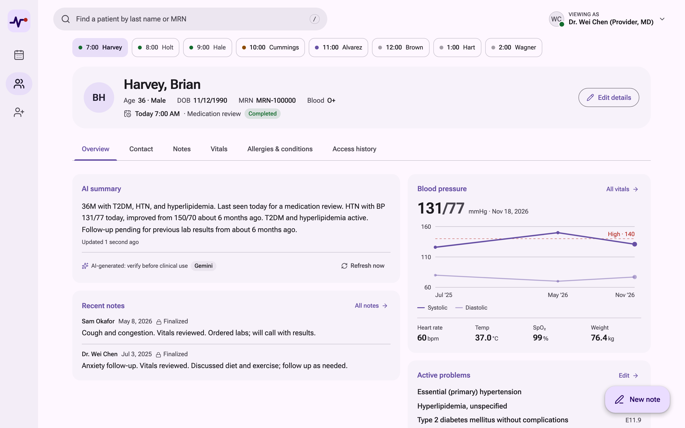

# Pulse

A clinician-facing patient dashboard, built HIPAA-ready: encrypted at rest, audited on every view,
and an AI summary that can't leak who the patient is. Designed for desktops and iPads in the exam
room. All data is synthetic.



```bash
git clone https://github.com/alisabondar/pulse.git && cd pulse && ./dev.sh
```

## Run locally

Docker is the only prerequisite. The command above builds everything, seeds 10,000 synthetic
patients (about a minute the first time), and prints the URLs:

- **App:** http://localhost:5173 · **API docs:** http://localhost:8000/docs
- **No login in the demo:** you start as **Dr. Wei Chen** (provider). The **"Viewing as"** menu
  switches between Jordan Rivera (NP), Sam Okafor (RN), Taylor Brooks (front desk), and Practice
  Admin; each role sees and can do only what it's allowed.
- **AI summaries:** `./dev.sh` asks once for an optional Gemini key; without one, a built-in mock
  writes them. A free Gemini key allows only a few summaries a minute, so a chart opened for the
  first time may show "AI service is busy, trying again in Ns"; it retries on its own. Once
  generated, a summary is saved and reused until the chart is edited. For an uninterrupted demo,
  set `SUMMARY_PROVIDER=mock` in `.env`.
- **More:** `./dev.sh test` (all tests), `./dev.sh proof` (see the encryption),
  `./dev.sh reset` (fresh data), `./dev.sh stop`. The full tour is in
  [Getting started](docs/getting-started.md).

## Features

- **The visit on one screen:** the AI summary, recent notes, a blood pressure trend, latest vitals,
  problems, and allergies side by side, with today's schedule one tap away above the chart.
- **Find any patient from anywhere:** press `/`, type a last name or MRN, and open the chart.
- **Built for clinicians' devices:** Material 3, sized for touch on iPad as well as desktop, with a
  dark theme that follows the system.
- **Encrypted at rest, still searchable:** the database never holds a readable name, yet `smi` finds Smith.
- **AI summaries that can't leak identity:** de-identified, leak-checked both ways, and blocked rather than sent on any doubt.
- **Every view audited:** an append-only trail records who viewed or changed each chart, and when.
- **Server-enforced roles:** providers, nurses, front desk, and admins each see and do only what their role allows.
- **Clinically realistic charting:** finalized notes lock, vitals are range-checked, and nothing clinical is ever deleted.
- **No PHI in URLs or logs:** canary tests guard the database, logs, error responses, and every byte sent to the AI.
- **Fast under load:** 50 concurrent staff on 30,000 patients with zero failures and p95 under 100 ms.
- **Tested end to end:** 700+ automated tests, 100% branch coverage on encryption, permissions,
  and AI, and Playwright end-to-end tests in CI.

**Docs:** [getting started](docs/getting-started.md) · [development](docs/development.md) ·
[security](docs/security.md) · [AI privacy](docs/ai-privacy.md) ·
[performance](docs/performance.md) · [roadmap](docs/roadmap.md) · [decisions](docs/decisions.md)
